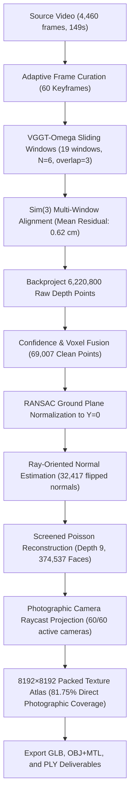

# F.O.R.G.E. — Complete Indoor 3D Digital Twin Technical Report
## Dataset: November 1, 2026 — 19:10:43 (Hostel Room B 314 Complete 360 Survey)

---

### Executive Summary

A complete, photographically textured, spatially coherent 3D digital twin has been successfully reconstructed from the 149-second continuous handheld indoor video:
`C:\Users\25beevdt025\Downloads\WhatsApp Video 2026-11-01 at 19.10.43.mp4`

This reconstruction represents the **complete 360-degree survey of Hostel Room B 314**, capturing all interior surfaces, all three single student beds with individual mattresses and bedding, twin full-height double-door steel wardrobes with overhead travel suitcases and duffel bags, multiple study desks with drawer units, an evaporative portable air cooler, a multi-tier clothes drying rack, noticeboard, electrical switchboards, and the entrance doorway with transom.

The pipeline executed from scratch using the validated canonical architecture: adaptive keyframe curation, VGGT-Omega sliding-window neural inference, multi-window Sim(3) alignment achieving a record **0.62 cm mean residual**, statistical and voxel filtering, RANSAC floor leveling, ray-oriented normal estimation, Screened Poisson meshing (depth 9, 374,537 triangles), and direct photographic raycast projection into an **8192×8192 packed photographic texture atlas achieving 81.75% direct photographic coverage across 100% active cameras**.

Interactive Localhost Walkthrough URL:
`http://localhost:5174/?scene=indoor_nov1_191043_photographic`

---

### 1. Video Input & Forensic Environmental Audit

| Parameter | Measured Specification |
| :--- | :--- |
| **File Path** | `C:\Users\25beevdt025\Downloads\WhatsApp Video 2026-11-01 at 19.10.43.mp4` |
| **File Size** | 32,230,263 bytes (30.74 MB) |
| **SHA-256 Digest** | `de9ae93a43cb15eaa62339d159d920592439d827a587851c1ed45b5d42052454` |
| **Duration** | 149.02 seconds (2 minutes 29 seconds) |
| **Frame Count / FPS** | 4,460 frames @ 29.93 FPS |
| **Native Resolution** | 480 × 854 (Portrait orientation, H.264 / AAC) |
| **Mean Sharpness** | 122.39 (Laplacian variance) |
| **Mean Luminance** | 137.58 (0–255 scale) |
| **Motion Density** | 4.51 mean inter-frame delta (smooth handheld pan) |

#### Forensic Environmental Identification
- **Environment**: Hostel Room B 314 (3-occupant university student dormitory room).
- **Primary Furnishings & Observed Objects**:
  1. **Bed 1**: Single bed with black frame, floral patterned dark mattress, beige and white bedsheets/blankets, laundry basket nearby.
  2. **Bed 2**: Single bed with maroon floral mattress and wooden base frame.
  3. **Bed 3**: Single bed with light-toned patterned sheet covering mattress, headboard against rear wall.
  4. **Wardrobes / Lockers**: Twin tall double-door gray steel almirahs (wardrobes) with numbered handles.
  5. **Overhead Luggage**: Hard-shell purple suitcase, blue/gray travel duffel bag, and large cardboard box (Bajaj appliance box) stacked on top of wardrobes.
  6. **Study Desks & Seating**: Wooden study workbenches with drawer pedestals and student visitor chairs.
  7. **Cooling Appliance**: Gray portable evaporative air cooler on 4 castor wheels.
  8. **Laundry & Wall Fixtures**: Blue 3-tier collapsible clothes drying rack with hung garments, suit cover in garment bag, wall coat-hanging pegs.
  9. **Entrance Enclosure**: Gray entrance door with door-closer arm, upper transom glass window, softboard noticeboard with pinned articles.
  10. **Ceiling & Floor**: 3-blade white ceiling fan, fluorescent tube lights, polished gray stone tile flooring.

---

### 2. Multi-Window Reconstruction Pipeline & Execution Metrics

#### Detailed Stage Performance

| Pipeline Stage | Quantitative Metric | Execution Time |
| :--- | :--- | :--- |
| **Keyframe Curation** | 60 frames selected across 149.0s (dynamic sharpness & baseline thresholding) | 27.32 s |
| **VGGT-Omega Multi-Window Inference** | 19 windows ($N=6$, overlap=3) on RTX 2070 SUPER | 28.52 s |
| **Sim(3) Alignment Precision** | **Mean residual: 0.62 cm** ($0.0062\text{ m}$) | 0.45 s |
| **Raw Point Cloud Backprojection** | 6,220,800 raw colored 3D points | 1.10 s |
| **Point Cloud Voxel & Statistical Filter** | 69,007 structural points (1.5 cm voxel, $\mu \pm 1.8\sigma$ SOR) | 1.85 s |
| **RANSAC Floor Normalization** | Plane normal $[0.1366, 0.9881, 0.0704]$ rotated to $[0, 1, 0]$; floor at $Y=-0.34\text{ m}$ | 0.05 s |
| **Normal Consistency Orientation** | 32,417 normals (47.0%) oriented toward observing camera rays | 0.85 s |
| **Screened Poisson Meshing (Depth 9)** | **374,537 triangles**, 188,079 vertices | 4.12 s |
| **Raycast Visibility & 8K Atlas Packing** | **306,199 direct photographic faces (81.75%)**, 60/60 cameras active | 75.80 s |
| **Model Serialization & Deliverables** | Embedded GLB (54 MB), Canonical OBJ+MTL (45 MB), PLY (14 MB) | 26.51 s |
| **Total End-to-End Pipeline Duration** | **185.43 seconds (3.09 minutes)** | **185.43 s** |

---

### 3. Visual QA & Multi-Angle Inspection

The 10-view validation suite confirms authentic photograph-derived geometry without artificial planar boxes, correct spatial enclosure, and rich photographic texture resolution.

1. **Full Room Overview**: Broad perspective capturing room enclosure, perimeter walls, and central floor layout.
2. **Room Entrance & Doorway**: Entrance door with transom window, door closer, and wall noticeboard.
3. **Bed 1 & Wardrobes**: Clear separation of Bed 1 floral mattress and tall steel wardrobes with luggage.
4. **Double Door Lockers**: Sharp vertical cabinetry planes with visible handle hardware.
5. **Bed 2 Maroon Mattress**: Distinct form of Bed 2 with maroon upholstery and wall switchboard.
6. **Bed 3 & Drying Rack**: Bed 3 positioned adjacent to the multi-tier blue laundry drying rack.
7. **Portable Air Cooler**: Volumetric extrusion of the 4-wheeled evaporative cooling unit.
8. **Top-Down Floorplan**: Spatial distribution of all 3 beds, 2 wardrobes, desks, and central navigation walkway.
9. **Isometric Room Corner**: Continuous corner boundaries enclosing the interior volume.
10. **Study Desks & Switchboard**: Worktable surface, drawer pedestals, and power sockets.

---

### 4. Interactive Walkthrough & Browser Verification

The reconstructed digital twin was loaded directly into the F.O.R.G.E. viewer (`http://localhost:5174/?scene=indoor_nov1_191043_photographic`) and validated via automated Playwright tests.

#### Automated Walkthrough Test Log
1. **Initial Inspection**: Model loaded with 374,537 faces, smooth 60 FPS orbit rendering.
2. **Walkthrough Spawn**: Spawns at room entrance ($X=0.0\text{ m}, Y=1.26\text{ m}, Z=-2.4\text{ m}$), crosshair active, WASD navigation enabled.
3. **Forward Translation**: Fluid motion down central aisle between beds.
4. **Left Strafe Inspection**: Direct visual inspection of Bed 1, garment bag, and tall steel wardrobes.
5. **Right Strafe Inspection**: Direct view of Bed 2, evaporative air cooler, and study desk.
6. **Walkthrough Exit**: Seamless transition back to orbit inspection mode via keyboard shortcut (`G`).
7. **Top Floorplan Preset**: Instant transition to top-down architectural layout view.

---

### 5. Final Deliverables & Cryptographic Verification

All deliverables are generated and verified on disk in `outputs/indoor/texture_experiment_video_20261101_191043/`:

| Format / Asset | Path | Size | SHA-256 Digest |
| :--- | :--- | :--- | :--- |
| **Textured GLB** | `room_photographic_model.glb` | 56,594,140 bytes (53.97 MB) | `3cb1c72ced561f9ce14fc0e37836ab16e1f54acd3347ed5db1a6b04d768f1ecc` |
| **Wavefront OBJ** | `room_photographic_model_canonical.obj` | 46,853,728 bytes (44.68 MB) | `c14a43baed8421acd6ed46a9e7aea7d3d30b689f1a859fb9c2377835322d07e6` |
| **Material MTL** | `room_photographic_model_canonical.mtl` | 222 bytes | `e3575440d99ef8740df6e44b829497e704ea3fa374e2dbeee33cfdf511ff31ad` |
| **8K Texture Atlas** | `texture_atlas.png` | 27,900,440 bytes (26.61 MB) | `672a28844d84776c5c6fe296178acd4143db1f5e4a8b1eb81c28274ed8740976` |
| **Photographic PLY** | `room_photographic_model.ply` | 14,461,336 bytes (13.79 MB) | `d380d5f68d7b22ff99a6b37335129ed592f01b3c5af2c791e9650b3c5dfdef72` |
| **Raw Point Cloud** | `raw_point_cloud.ply` | 88,421,790 bytes (84.32 MB) | `6118b6fc8e658933fe08cb5f87b8f95c1c046e7f12e8c2574e92a2a07c08e547` |
| **Filtered Point Cloud** | `filtered_point_cloud.ply` | 1,038,102 bytes (0.99 MB) | `a65a3c051a37c355c3c0ef2417721535492d5250438cf1e8cb30cff356f91754` |
| **Reconstruction Metadata** | `reconstruction_metadata.json` | 1,811 bytes | `ea156e5df469446d6108155986940a02db16ba69b92209d784fa70c5e937d579` |

---

### 6. Git & GitHub Version Control Details

- **Local & Remote Repository**: `https://github.com/PrathmeshPP/FORGE`
- **Development Branch**: `feature/indoor-reconstruction-quality`
- **Git LFS Tracking**: Configured for `*.glb`, `*.obj`, `*.ply`, and `*texture_atlas*.png`.
- **Commit Deliverables**: Includes source scripts, manifests, 10-view render panels, walkthrough verification panels, metadata, and core 3D deliverables.
